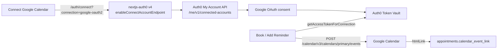

# Anna's Dog Grooming — Phase 2

**Token Vault + Google Calendar reminders** · built on Phase 1.

Anna wants every grooming appointment to land on the customer's own Google Calendar. The tempting shortcut is a `google_refresh_token` column in SQLite. **Don't.** Auth0 **Token Vault** holds the Google tokens; this app only ever sees a short-lived access token from `auth0.getAccessTokenForConnection({ connection: "google-oauth2" })`.

```bash
git checkout phase-2-calendar
npm install
npm run dev
```

Your Phase 1 SQLite file carries over. `lib/db.ts` runs an idempotent `ALTER TABLE ... ADD COLUMN` for `calendar_event_id` and `calendar_event_link` if they are missing.

---

## Why Phase 1's Google login is not enough

The default Google social connection on a new Auth0 tenant uses **Auth0's shared developer keys**. Those keys are perfect for "can I click Sign in with Google?" in Phase 1.

They do **not**:

- Issue Google **refresh tokens**
- Allow **Token Vault / Connected Accounts**
- Let this app call `GET/POST https://www.googleapis.com/calendar/v3/...`

Phase 2 swaps in **your own Google Cloud OAuth Client ID + Secret**, then turns on Token Vault so `/auth/connect` can store Google tokens in Auth0 — never in `data/anna-grooming.db`.

---

## Architecture



---

## Google Cloud Console walkthrough

1. Open [Google Cloud Console](https://console.cloud.google.com/) and create (or pick) a project.
2. **APIs & Services → Library** → enable **Google Calendar API**.
3. **APIs & Services → OAuth consent screen**
   - User type: **External** is fine for a workshop.
   - App name: `Anna's Dog Grooming`.
   - Add your email as a test user.
   - Scopes: `openid`, `email`, `profile`, and `https://www.googleapis.com/auth/calendar.events` (or the broader `https://www.googleapis.com/auth/calendar`).
4. **APIs & Services → Credentials → Create credentials → OAuth client ID**
   - Application type: **Web application**.
   - Authorized redirect URI — this is Auth0's callback, **not** localhost:

     ```
     https://YOUR-TENANT.us.auth0.com/login/callback
     ```

5. Copy the **Client ID** and **Client Secret**.

---

## Auth0 Dashboard walkthrough

Do this by hand in the dashboard. No CLI, no Management API.

### 1. Put your Google keys on the connection

1. **Authentication → Social → Google**.
2. Replace Auth0's developer keys with the Google Cloud Client ID + Secret.
3. Open **Permissions** and enable **Offline Access**. Token Vault cannot refresh without it.
4. Under **Purpose**, enable **Connected Accounts for Token Vault** (keep **Authentication** on so Phase 1 Google login still works).
5. **Save**.

### 2. Enable the Token Vault grant on the app

1. **Applications → Anna's Dog Grooming → Settings → Advanced Settings → Grant Types**.
2. Check **Token Vault** (and keep **Authorization Code** + **Refresh Token**).
3. **Save Changes**.

### 3. Activate the My Account API *(required by v4 Connected Accounts)*

`/auth/connect` talks to `https://<AUTH0_DOMAIN>/me/v1/connected-accounts`. That is the **My Account API**.

1. **Applications → APIs** → activate **Auth0 My Account API**.
2. Open it → **Application Access** → find *Anna's Dog Grooming* → **Edit**.
3. **User Access** → **Authorized**.
4. Permissions: select **all Connected Accounts scopes**
   (`create:me:connected_accounts`, `read:me:connected_accounts`, `delete:me:connected_accounts`).
5. **Save**.
6. On the API **Settings** tab, under Access Settings, allow skipping user consent if you are using Multi-Resource Refresh Tokens.

### 4. Multi-Resource Refresh Token (MRRT)

1. **Applications → Anna's Dog Grooming → Multi-Resource Refresh Token → Edit Configuration**.
2. Toggle on **My Account API**.
3. Save.

### Pro tips

- **Free plan** includes up to **2 Token Vault connections**. Google counts as one. Don't enable every social provider "just in case."
- Request `offline_access` **and** `https://www.googleapis.com/auth/calendar.events` (or `calendar`). The Connect button in this app already sends those as `scopes` query params.
- If Connect fails with a consent or refresh-token error, you are almost always still on Auth0's Google developer keys.
- MFA set to **Always** blocks Token Vault exchanges. Use **Never** for the workshop, or customize MFA with an Action.

---

## Try it

1. Sign in at [http://localhost:3000](http://localhost:3000).
2. Click **Connect Google Calendar** — you should hit Google's consent screen, then land back on `/`.
3. Book a visit (or click **Add Reminder to Calendar** on an existing Phase 1 appointment).
4. The appointment card grows a **View in Google Calendar ↗** badge from the event's `htmlLink`.

If Google isn't connected yet, booking still succeeds. The reminder button explains what the tenant still needs.

---

## Code tour — the Phase 1 diff

### `lib/auth0.ts`

```ts
export const auth0 = new Auth0Client({
  enableConnectAccountEndpoint: true, // mounts /auth/connect
  authorizationParameters: {
    scope: "openid profile email offline_access",
  },
});
```

The Connect button hits:

```
/auth/connect?connection=google-oauth2&returnTo=/&scopes=openid&scopes=profile&scopes=email&scopes=offline_access&scopes=https://www.googleapis.com/auth/calendar.events
```

### `lib/google-calendar.ts`

```ts
const { token } = await auth0.getAccessTokenForConnection({
  connection: "google-oauth2",
});

await fetch("https://www.googleapis.com/calendar/v3/calendars/primary/events", {
  method: "POST",
  headers: { Authorization: `Bearer ${token}` },
  body: JSON.stringify({ summary, start, end }),
});
```

The Google refresh token never touches this process. SQLite only stores `calendar_event_id` / `calendar_event_link`.

### `lib/db.ts`

Idempotent migration so a Phase 1 database keeps working:

```ts
await ensureColumn(db, "appointments", "calendar_event_id", "TEXT");
await ensureColumn(db, "appointments", "calendar_event_link", "TEXT");
```

---

## After the workshop / keep building

Phase 2 put reminders on a human's calendar. Phase 3 lets an **AI agent** book as that same customer — OAuth 2.1 + DCR, never a shared API key.

```bash
git checkout phase-3-mcp
npm install
npm run dev
```

---

## Scripts

```bash
npm run dev
npm run build
npm run lint
```
