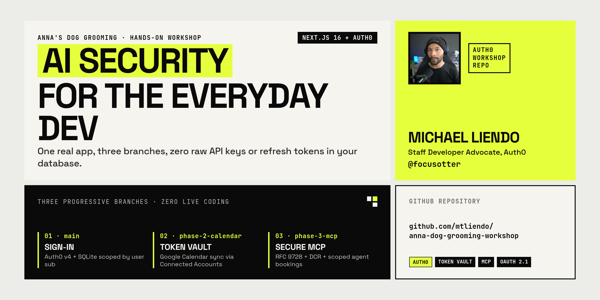

# Anna's Dog Grooming — Phase 2

**Token Vault + Google Calendar reminders** · built on Phase 1.

Anna wants every grooming appointment to land on the customer's own Google Calendar. The tempting shortcut is a `google_refresh_token` column in SQLite. **Don't.** Auth0 **Token Vault** holds the Google tokens; this app only ever sees a short-lived access token from `auth0.getAccessTokenForConnection({ connection: "google-oauth2" })`.

```bash
git checkout phase-2-calendar
npm install
npm run dev
```

Your Phase 1 SQLite file carries over. `lib/db.ts` runs an idempotent `ALTER TABLE ... ADD COLUMN` for `calendar_event_id` and `calendar_event_link` if they are missing.

Screenshots below are from a real workshop tenant. In prose we write **`<YOUR_AUTH0_DOMAIN>`** (for example `your-tenant.us.auth0.com`). The images still show the demo tenant we used while recording — your slug will be different.

If the in-app **Workshop Setup Needed** card is still up, paste callback / logout / CORS values on the application's **URLs** tab (not Settings), press **Enter** so each becomes a **DEV** chip, then **Save**.

---

## What you're building

Before Token Vault is linked, the salon shows a **Connect Google Calendar** card and an **Add Reminder to Calendar** action on each visit:

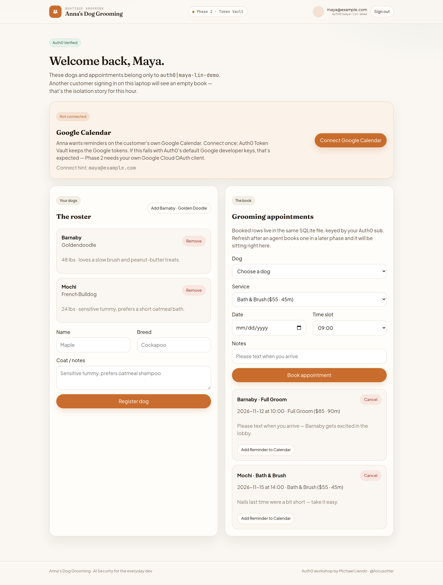

After the customer connects, Auth0 Token Vault holds the Google tokens. Appointments grow a **View in Google Calendar** badge from `calendar_event_link` — still no refresh token in SQLite:

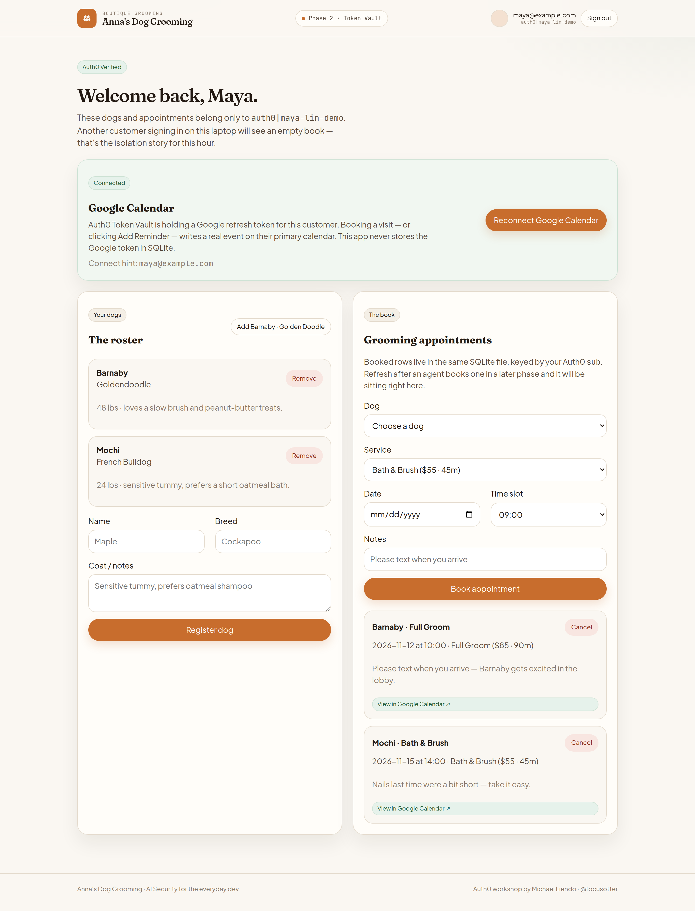

---

## Why Phase 1's Google login is not enough

The default Google social connection on a new Auth0 tenant uses **Auth0's shared developer keys**. Those keys are perfect for "can I click Sign in with Google?" in Phase 1.

They do **not**:

- Issue Google **refresh tokens**
- Allow **Token Vault / Connected Accounts**
- Let this app call `GET/POST https://www.googleapis.com/calendar/v3/...`

That starting point looks like this — Token Vault radios exist, **Offline Access** and **Calendar** are still unchecked, and the yellow development-keys banner is still up:

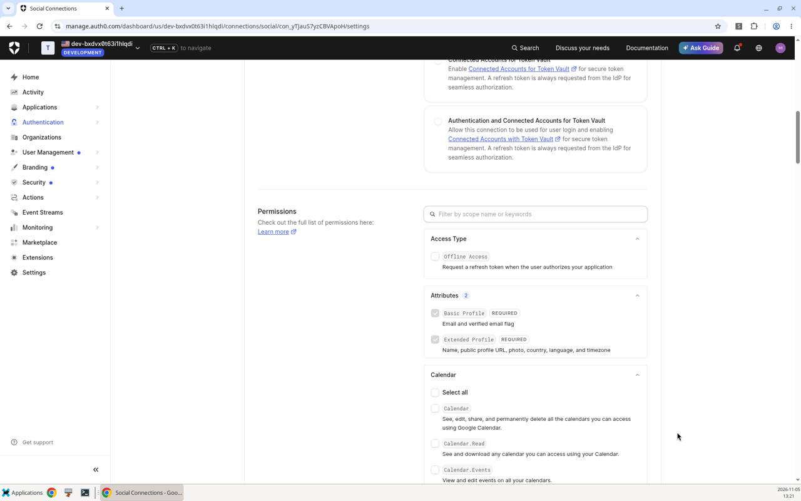

Phase 2 swaps in **your own Google Cloud OAuth Client ID + Secret**, then turns on Token Vault so `/auth/connect` can store Google tokens in Auth0 — never in `data/anna-grooming.db`.

---

## Architecture

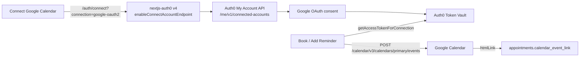

---

## Google Cloud Console (self-paced)

Do this in [Google Cloud Console](https://console.cloud.google.com/) before touching Auth0 again.

### 1. Create a project

**New Project** — name it something like `Anna Dog Grooming Workshop`, then **Create**.

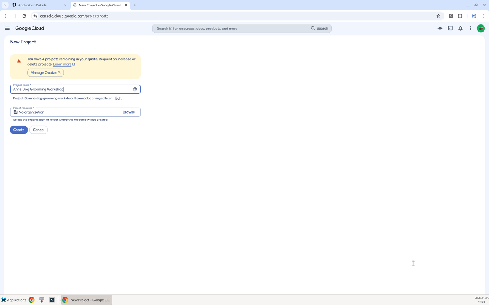

### 2. Enable the Google Calendar API

**APIs & Services → Library** → search **Google Calendar API** → **Enable**. You should land on a page whose status is **Enabled**.

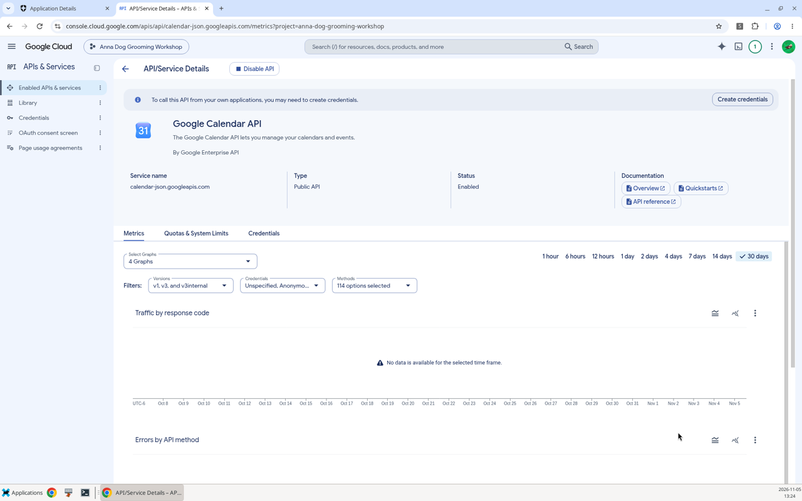

### 3. Branding & Audience (Google Auth Platform)

Open **Google Auth Platform → Branding** and fill in the app name / support email.

Then open **Audience**:

- **User type:** **External**
- **Publishing status:** **Testing**

> **Important Pro Tip — Test users:** under **Test users** you **must** add an email associated with a **real Google / Gmail or Google Workspace account**. Google rejects `+alias` addresses and non-Google-account emails. If Connect fails with a vague "access denied" after consent, this is usually why.

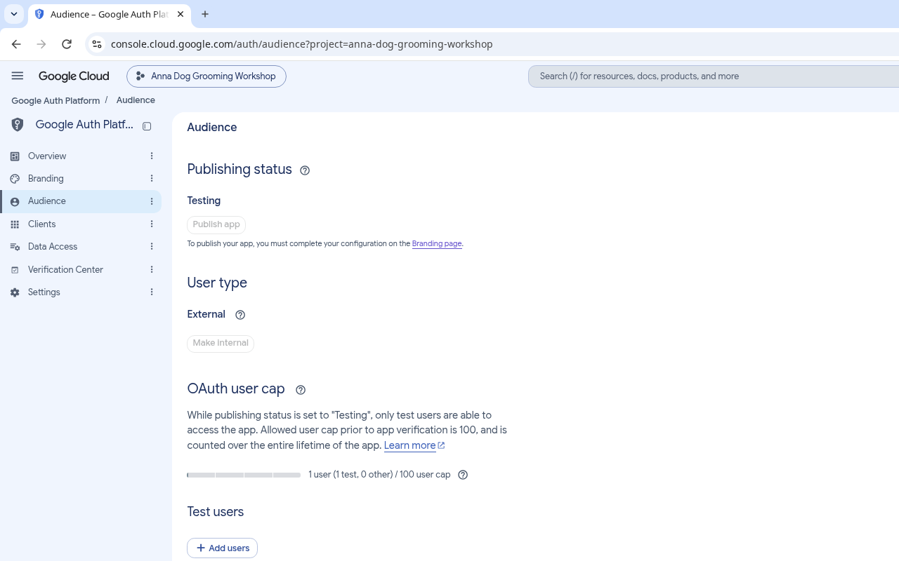

### 4. Create the OAuth client

**Google Auth Platform → Clients → Create Client**

- Application type: **Web application**
- Name: `Anna's Dog Grooming Auth0` (or similar)
- **Authorized redirect URI** — this is Auth0's callback, **not** localhost:

  ```
  https://<YOUR_AUTH0_DOMAIN>/login/callback
  ```

Copy the **Client ID** and **Client Secret**.

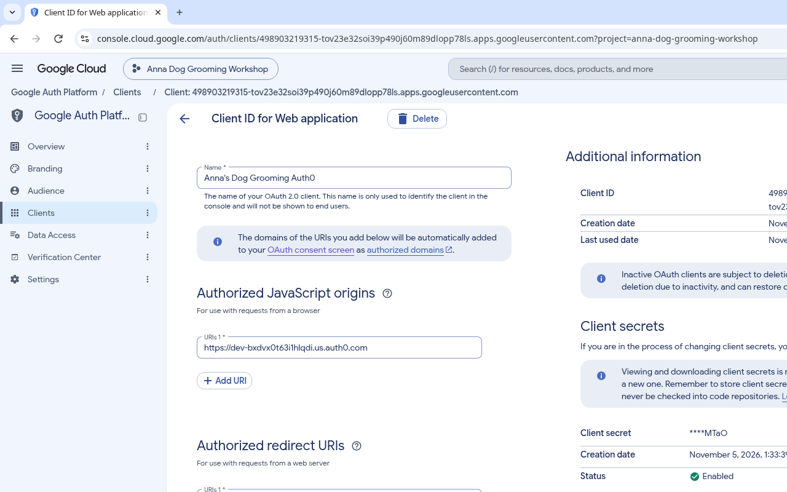

---

## Auth0 Dashboard — 4 checkpoints (November 2026 UI)

Do this by hand. No CLI, no Management API.

### Checkpoint 1 — `Authentication → Social → google-oauth2`

1. Paste your Google **Client ID** and **Client Secret**.
2. Select the **second** radio card: **"Authentication and Connected Accounts for Token Vault"** — so Google still works for Phase 1 sign-in *and* for `/auth/connect`.
3. If Auth0 prompts **"Offline Access Required"**, click **Enable & Continue**.
4. Under **Permissions**, verify **Offline Access** is checked.
5. Scroll to **Calendar**, check **Calendar** and/or **Calendar.Events**.
6. Click **Save Changes**. The yellow *"This connection is using Auth0 development keys"* banner disappears.

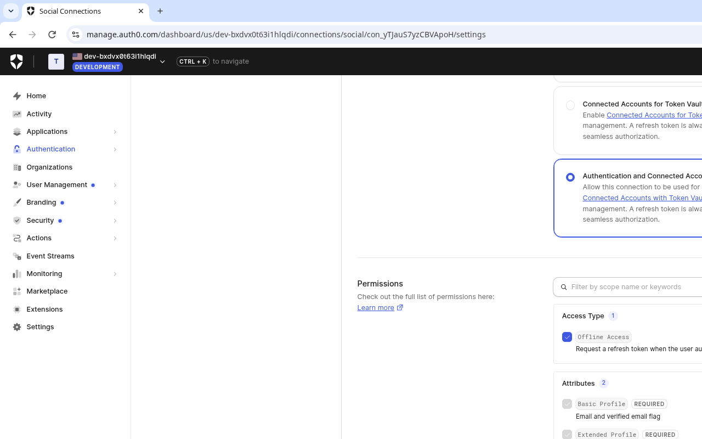

### Checkpoint 2 — Activate the My Account API

`/auth/connect` talks to `https://<YOUR_AUTH0_DOMAIN>/me/v1/connected-accounts`. That is the **My Account API**.

Go to **Applications → APIs** and click **Activate** on the **My Account API** card.

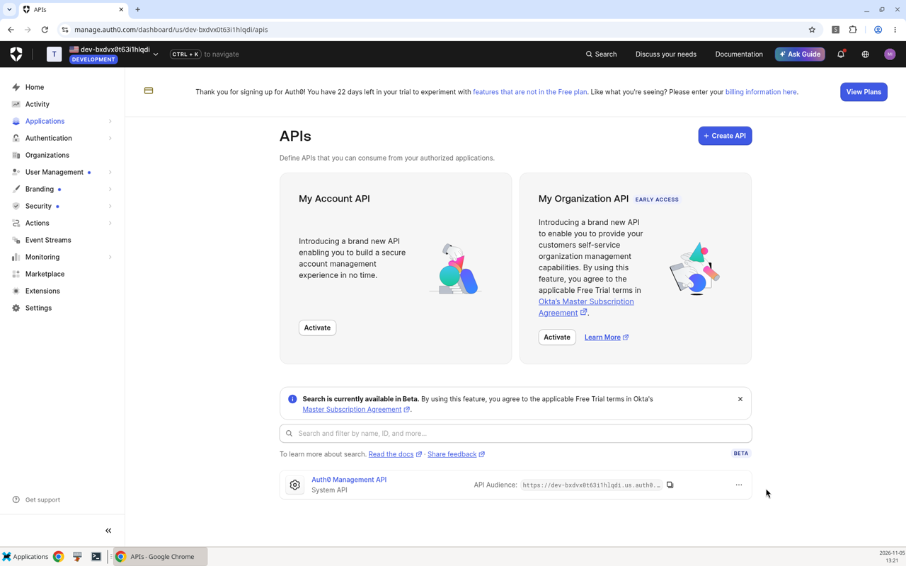

After the green toast, you configure permissions from the *application's* **API Access** tab (Checkpoint 4) — even if the system API row does not immediately appear on this APIs list.

### Checkpoint 3 — Enable the Token Vault grant type

**Applications → Applications → Anna's Dog Grooming → Settings → Advanced Settings → Grant Types**

Check **Token Vault**, then click **Save Changes**. Keep **Authorization Code** and **Refresh Token** checked.

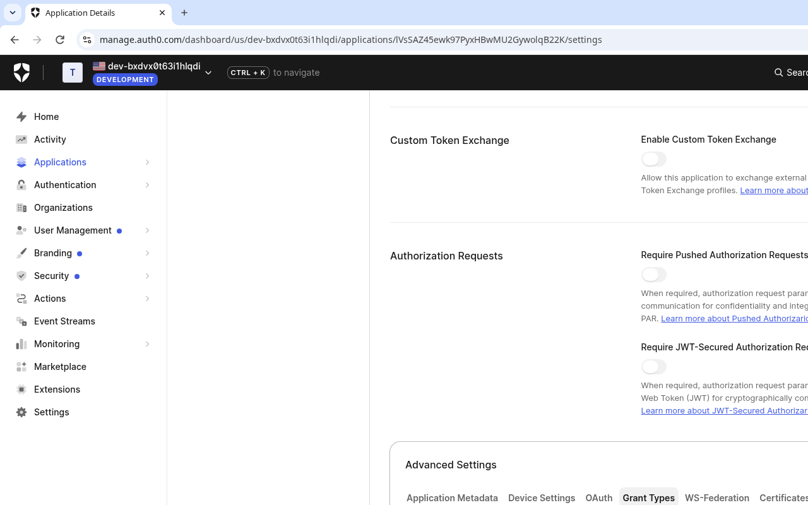

### Checkpoint 4 — Grant My Account API user-delegated scopes

Still on **Anna's Dog Grooming**, click the **API Access** tab.

Find **Auth0 My Account API (SYSTEM)**. Under **User-delegated Access**, grant the three Connected Accounts permissions:

- `create:me:connected_accounts`
- `read:me:connected_accounts`
- `delete:me:connected_accounts`

The row should read **3 / 8 permissions granted**.

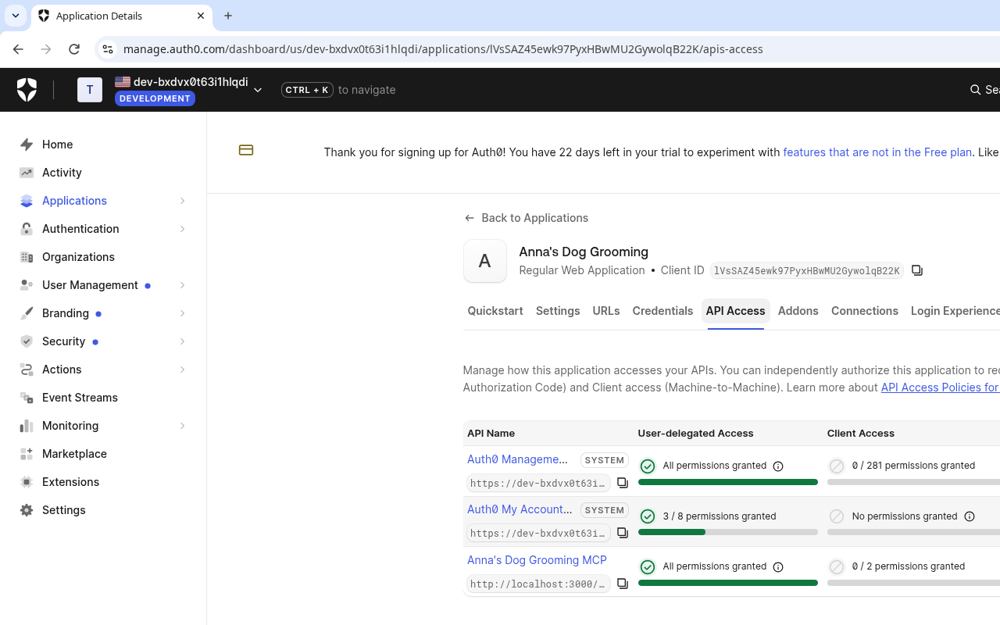

### Pro tips

- **Free plan** includes up to **2 Token Vault connections**. Google counts as one. Don't enable every social provider "just in case."
- This app's Connect button already requests `offline_access` and `https://www.googleapis.com/auth/calendar.events`.
- If Connect fails with a consent or refresh-token error, you are almost always still on Auth0's Google developer keys (Checkpoint 1).
- MFA set to **Always** blocks Token Vault exchanges. Use **Never** for the workshop, or customize MFA with an Action.

---

## Try it

1. Sign in at [http://localhost:3000](http://localhost:3000).
2. Click **Connect Google Calendar** — you should hit Google's consent screen, then land back on `/`.
3. Book a visit (or click **Add Reminder to Calendar** on an existing Phase 1 appointment).
4. The appointment card grows a **View in Google Calendar ↗** badge from the event's `htmlLink`.

If Google isn't connected yet, booking still succeeds. The reminder button explains what the tenant still needs.

---

## Code tour — the Phase 1 diff

### `lib/auth0.ts`

```ts
export const auth0 = new Auth0Client({
  enableConnectAccountEndpoint: true, // mounts /auth/connect
  authorizationParameters: {
    scope: "openid profile email offline_access",
  },
});
```

The Connect button hits:

```
/auth/connect?connection=google-oauth2&returnTo=/&scopes=openid&scopes=profile&scopes=email&scopes=offline_access&scopes=https://www.googleapis.com/auth/calendar.events
```

### `lib/google-calendar.ts`

```ts
const { token } = await auth0.getAccessTokenForConnection({
  connection: "google-oauth2",
});

await fetch("https://www.googleapis.com/calendar/v3/calendars/primary/events", {
  method: "POST",
  headers: { Authorization: `Bearer ${token}` },
  body: JSON.stringify({ summary, start, end }),
});
```

The Google refresh token never touches this process. SQLite only stores `calendar_event_id` / `calendar_event_link`.

### `lib/db.ts`

Idempotent migration so a Phase 1 database keeps working:

```ts
await ensureColumn(db, "appointments", "calendar_event_id", "TEXT");
await ensureColumn(db, "appointments", "calendar_event_link", "TEXT");
```

---

## After the workshop / keep building

Phase 2 put reminders on a human's calendar. Phase 3 lets an **AI agent** book as that same customer — OAuth 2.1 + DCR, never a shared API key.

```bash
git checkout phase-3-mcp
npm install
npm run dev
```

---

## Scripts

```bash
npm run dev
npm run build
npm run lint
```
