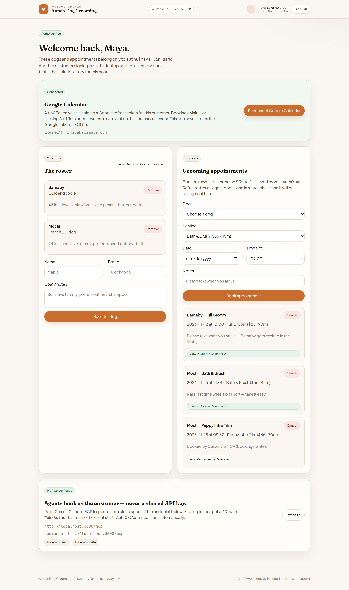
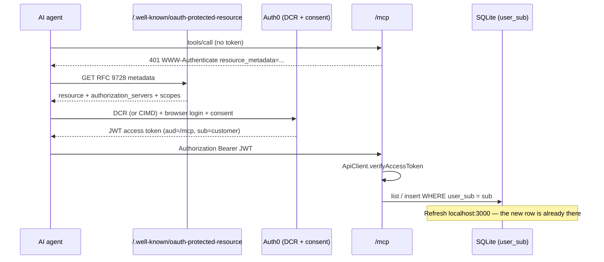
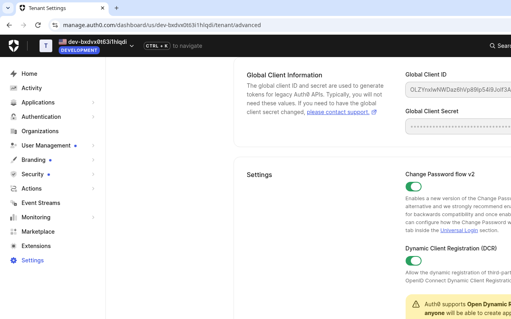
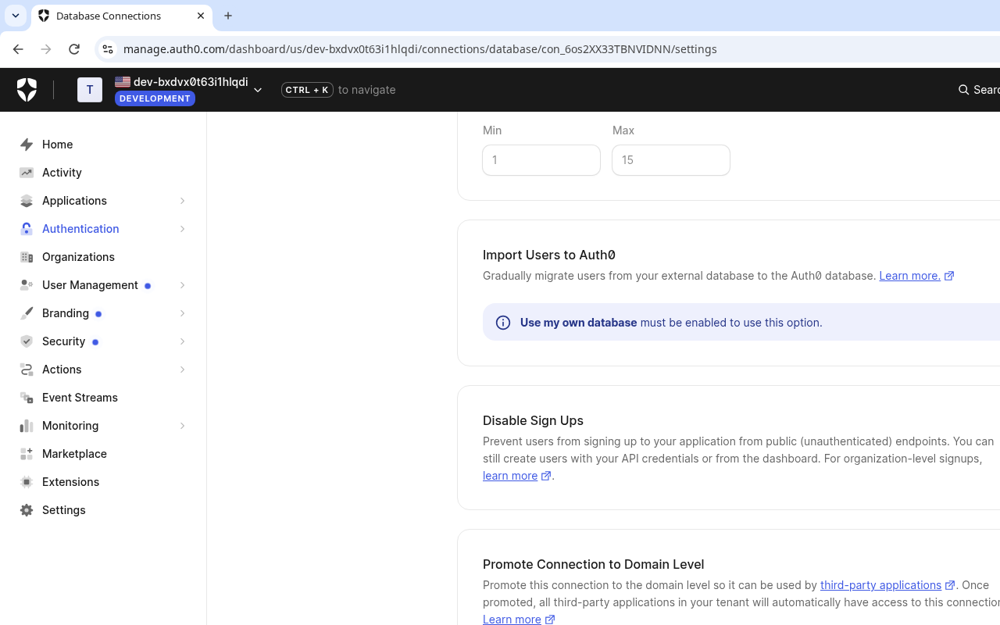
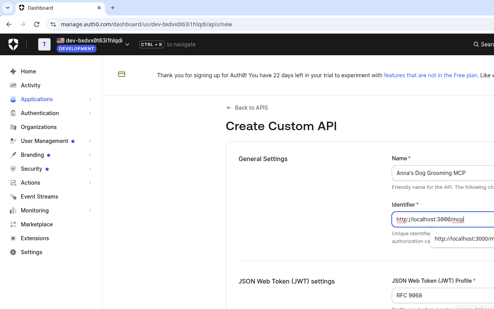
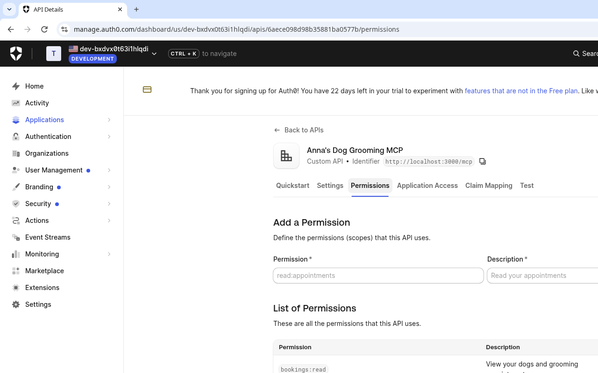
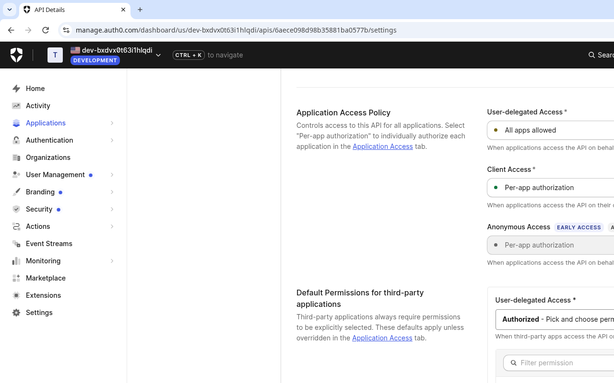

# Anna's Dog Grooming — Phase 3

**Secure MCP server for AI agents** · built on Phase 1 + Phase 2.

Anna's customers want Grok, Cursor, Claude Desktop, or Claude Code to manage their dogs and book visits **as them**. No shared static API key. The agent is an OAuth 2.1 client that dynamically registers with Auth0, the customer consents, and every tool call is scoped to the `sub` on the verified JWT.

```bash
git checkout phase-3-mcp
npm install
npm run dev
```

The salon UI, SQLite file, and Google Calendar reminders from earlier phases keep working.

If the in-app **Workshop Setup Needed** card is still up, paste callback / logout / CORS values on the application's **URLs** tab (not Settings), press **Enter** so each becomes a **DEV** chip, then **Save**.

Screenshots below are from a real workshop tenant. In prose we write **`<YOUR_AUTH0_DOMAIN>`** (for example `your-tenant.us.auth0.com`). The images still show the demo tenant we used while recording — your slug will be different.

---

## What you're building

The signed-in salon with Token Vault connected, plus the **MCP Server Ready** panel — `http://localhost:3000/mcp`, RFC 9728 metadata, `bookings:read` / `bookings:write`, and an 8-second live refresh. Mochi's Puppy Intro Trim below was booked by an AI agent.



Phase 2 context — the same customer after Google Calendar is linked via Auth0 Token Vault:


---

## Architecture



| Piece | Role |
| --- | --- |
| `app/mcp/route.ts` | Streamable MCP endpoint |
| `app/.well-known/oauth-protected-resource` | RFC 9728 metadata (root) |
| `app/.well-known/oauth-protected-resource/mcp` | RFC 9728 metadata for resource `…/mcp` |
| `@auth0/auth0-api-js` `ApiClient` | JWKS verification of `iss`, `aud`, `exp` |
| `mcp-handler` `withMcpAuth` | 401 + `WWW-Authenticate: Bearer resource_metadata="…"` |

---

## Local vs tunnel

| Who | `MCP_PUBLIC_URL` | Audience / API Identifier |
| --- | --- | --- |
| Self-paced (Cursor, Claude Code, Inspector) | *(omit — defaults to `APP_BASE_URL`)* | `http://localhost:3000/mcp` |
| Speaker / cloud agent (Grok Bot) | `https://xyz.trycloudflare.com` | `https://xyz.trycloudflare.com/mcp` |

Web login stays on `http://localhost:3000`. Only the MCP resource identifier changes for the tunnel.

```
MCP_PUBLIC_URL=https://xyz.trycloudflare.com
AUTH0_MCP_AUDIENCE=https://xyz.trycloudflare.com/mcp
```

---

## Auth0 Dashboard setup (November 2026 UI)

Do this by hand. No CLI, no Management API.

### 1. Enable DCR & CIMD

**Settings → Advanced**

Toggle **ON**:

- **Dynamic Client Registration (DCR)**
- **Client ID Metadata Document (CIMD) Registration** — if your MCP client uses CIMD

Both toggles **auto-save immediately**. No extra Save click on this page.



The 2026 MCP spec prefers Client ID Metadata Documents; DCR stays as the workshop-friendly fallback.

### 2. Promote connections to domain level

Dynamically registered MCP clients cannot use a connection that is only enabled for *Anna's Dog Grooming*. Domain-level is what lets Cursor / Claude / Inspector actually log the customer in.

Do **both** connections:

1. **Authentication → Database → Username-Password-Authentication**
2. **Authentication → Social → google-oauth2**

On each page, toggle **Promote Connection to Domain Level** **ON**, then click **Save** at the bottom.



### 3. Create the MCP API

**Applications → APIs → + Create API**

| Field | Value |
| --- | --- |
| Name | `Anna's Dog Grooming MCP` |
| Identifier | `http://localhost:3000/mcp` (or `https://<your-tunnel>/mcp` if you set `MCP_PUBLIC_URL`) |
| JSON Web Token Profile | **RFC 9068** |
| Signing Algorithm | **RS256** |



### 4. Add permissions

On the new API's **Permissions** tab, add:

| Permission | Description |
| --- | --- |
| `bookings:read` | List dogs and appointments |
| `bookings:write` | Add a dog or book a visit |



### 5. Application Access Policy — the unlock everyone misses

Stay on the API and open the **Settings** tab. Scroll to **Application Access Policy** and **Default Permissions for third-party applications**.

1. **Application Access Policy → User-delegated Access** → **All apps allowed**
2. **Default Permissions for third-party applications → User-delegated Access** → **Authorized - Pick and choose permissions**
3. Select both **`bookings:read`** and **`bookings:write`**
4. Click **Save**



> **This is the key unlock.** The default is **Unauthorized**. If you leave it there, MCP clients register fine, the customer logs in, and the token arrives with **zero** bookings scopes. Switching to **Authorized - Pick and choose permissions** and selecting both scopes is what lets DCR MCP clients request `bookings:read` / `bookings:write`.

### Free-plan hygiene

Each MCP client that dynamically registers counts as **1 application** toward the Free plan's **10-app** limit. Periodically delete unused DCR clients under **Applications → Applications**.

---

## Four tools, scoped to `sub`

| Tool | Scope | What it does |
| --- | --- | --- |
| `list_dogs` | `bookings:read` | Customer's dogs + the service menu |
| `add_dog` | `bookings:write` | `name`, `breed`, optional `notes` |
| `list_appointments` | `bookings:read` | Upcoming visits |
| `book_appointment` | `bookings:write` | `dog_name`, `service`, `date`, `time`, optional `notes` |

Every query is `WHERE user_sub = ?` using the JWT `sub`. Book with an agent, click **Refresh** (or wait 8 seconds) on [http://localhost:3000](http://localhost:3000) — the appointment is already in the web UI.

The **MCP Server Ready** panel on `/` shows the public resource URL, audience, and a copy-paste Cursor / Inspector snippet once `.env.local` is set.

---

## Client snippets

### Cursor — `~/.cursor/mcp.json`

```json
{
  "mcpServers": {
    "anna-dog-grooming": {
      "url": "http://localhost:3000/mcp"
    }
  }
}
```

Cursor discovers Auth0 from `/.well-known/oauth-protected-resource`, registers, and opens the browser.

### MCP Inspector

```bash
npx @modelcontextprotocol/inspector
```

Connect to `http://localhost:3000/mcp` with transport **Streamable HTTP**. The inspector will follow the 401 + resource metadata into Auth0.

### Claude Desktop / Claude Code

```json
{
  "mcpServers": {
    "anna-dog-grooming": {
      "type": "http",
      "url": "http://localhost:3000/mcp"
    }
  }
}
```

### Cloud agents (Grok Bot)

```bash
npx cloudflared tunnel --url http://localhost:3000
```

Then in `.env.local`:

```
MCP_PUBLIC_URL=https://YOUR-TUNNEL.trycloudflare.com
AUTH0_MCP_AUDIENCE=https://YOUR-TUNNEL.trycloudflare.com/mcp
```

Create (or update) the Auth0 API Identifier to that same audience. Add `https://YOUR-TUNNEL.trycloudflare.com/auth/callback` on the **URLs** tab only if the *web* login also goes through the tunnel. For MCP-only tunnels, the API Identifier is the important match.

---

## Extra Credit: Chaining MCP + Token Vault

Phase 2 already writes calendar reminders from the **web** session via Token Vault. Want `book_appointment` in MCP to do the same?

Auth0 can exchange the **incoming MCP access token** for a Google token without this app storing anything:

```ts
import { ApiClient } from "@auth0/auth0-api-js";

const api = new ApiClient({
  domain: process.env.AUTH0_DOMAIN!,
  audience: process.env.AUTH0_MCP_AUDIENCE!,
  clientId: process.env.AUTH0_CLIENT_ID!,
  clientSecret: process.env.AUTH0_CLIENT_SECRET!,
});

const { accessToken: google } = await api.getAccessTokenForConnection({
  connection: "google-oauth2",
  accessToken: incomingMcpJwt, // the agent's bearer token
});
```

Dashboard extras for this exchange:

1. The MCP API needs a **Custom API Client** (**Applications → APIs → Anna's Dog Grooming MCP → Add Application**) with the **Token Vault** grant.
2. The customer must have already clicked **Connect Google Calendar** in Phase 2 (or you initiate Connected Accounts from the agent).
3. Call `createAppointmentReminder` from `lib/google-calendar.ts` with that Google access token, then `saveCalendarEvent`.

Same SQLite row, same `htmlLink` badge — now written by the agent.

---

## Code tour

- `lib/auth0-mcp.ts` — `ApiClient({ domain, audience })` + `verifyAccessToken({ accessToken })`
- `app/mcp/route.ts` — `createMcpHandler` + `withMcpAuth(..., { required: true })`
- `lib/mcp-tools.ts` — four tools, `requireScopes("bookings:read"|"bookings:write")`, `sub` isolation
- Well-known routes reuse `generateProtectedResourceMetadata` from `mcp-handler`

---

## Scripts

```bash
npm run dev
npm run build
npm run lint
```
