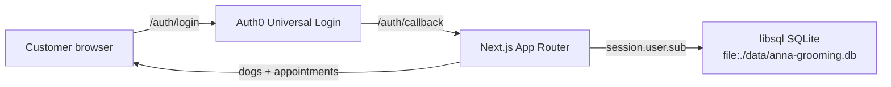
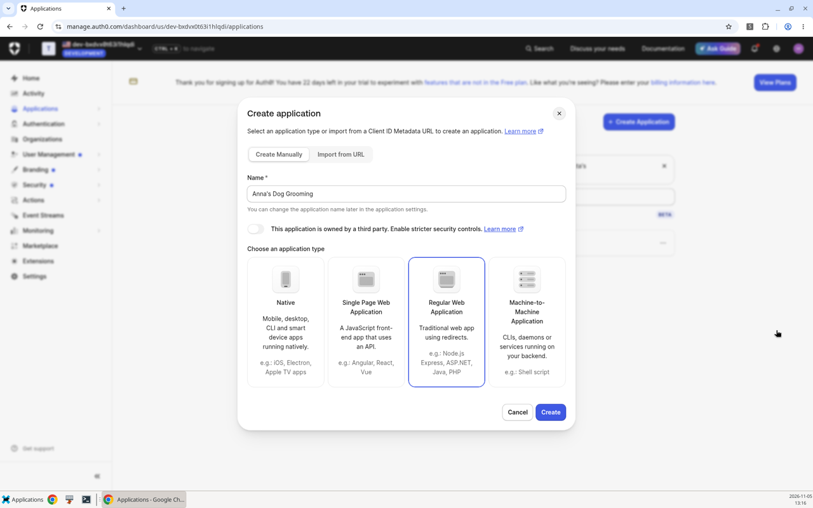
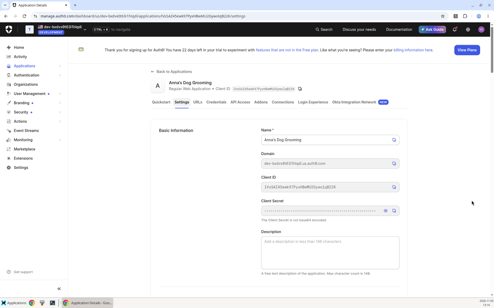
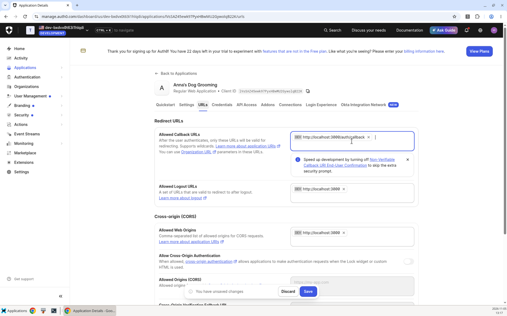
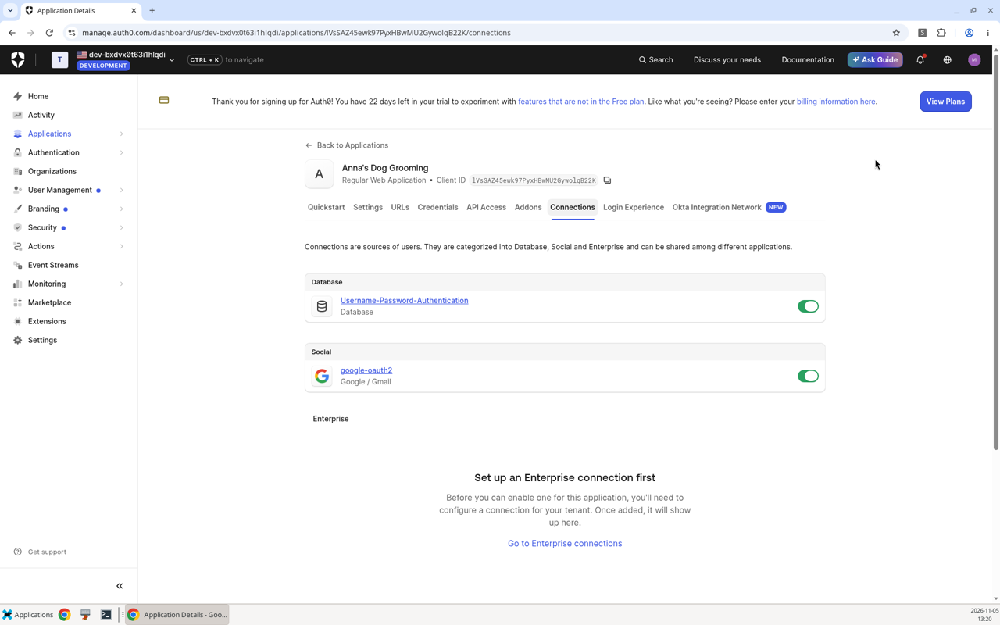
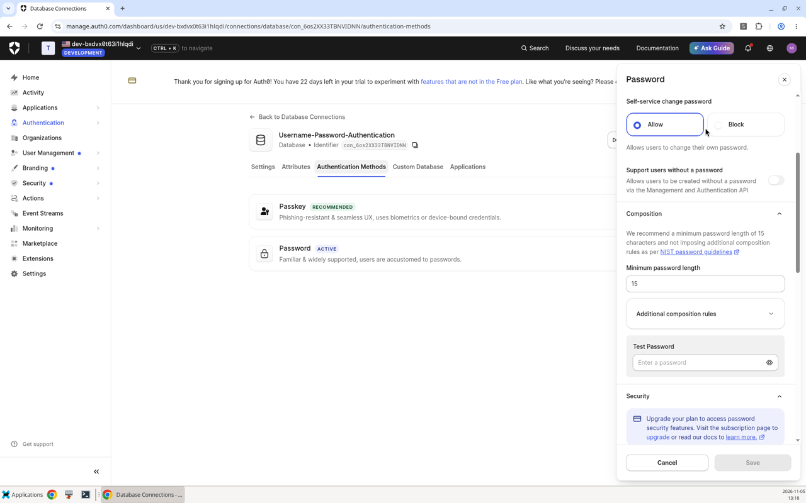
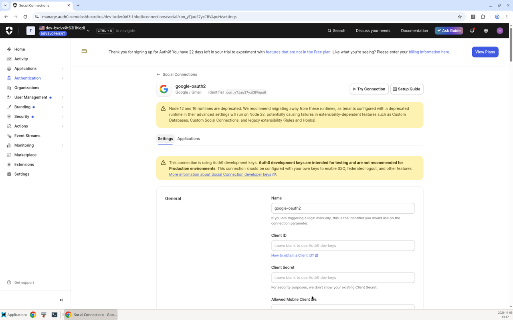

# Anna's Dog Grooming — Phase 1

**AI Security for the everyday dev** · a 1-hour hands-on workshop by [Michael Liendo](https://focusotter.com) ([@focusotter](https://x.com/focusotter)), Staff Developer Advocate at Auth0.

You're hired! Anna just opened a boutique grooming salon and needs software before the first doodle walks in. In this phase you will:

1. Sign customers in with **Auth0** (email + password *or* the default Google social connection).
2. Let each customer register their dogs and book a grooming appointment.
3. Store everything in a **local SQLite file** — scoped to `session.user.sub` so one customer never sees another customer's roster.

No extra databases. No Auth0 CLI. No native C++ addons. Attendees only need **Node.js 20+** and **Git**.

```bash
git clone https://github.com/mtliendo/anna-dog-grooming-workshop.git
cd anna-dog-grooming-workshop
npm install
cp .env.example .env.local
# fill in the Auth0 values (see below), then:
npm run dev
```

Open [http://localhost:3000](http://localhost:3000). Until `.env.local` is real, the app renders a **Workshop Setup Needed** card instead of crashing.

---

## Architecture



| Piece | Why it's here |
| --- | --- |
| `@auth0/nextjs-auth0` v4 | Cookie session, `/auth/login`, `/auth/logout`, `/auth/callback` |
| `@libsql/client` | Pure JS/WASM SQLite — **not** `better-sqlite3`, so macOS/Windows/Linux work without Xcode CLT or Python |
| `user_sub` on every row | The isolation story: identity from Auth0 is the row key |

---

## Prerequisites

- **Node.js 20+** and **npm** (this repo ships `package-lock.json` — please don't switch to pnpm/yarn mid-workshop)
- **Git**
- A free [Auth0](https://auth0.com/signup) account

That's it. No Postgres, no Redis, no Auth0 CLI, no Google Cloud project yet.

---

## Auth0 Dashboard setup (November 2026 UI)

All tenant work happens in the [Auth0 Dashboard](https://manage.auth0.com/). Do **not** run the Auth0 CLI or call the Management API. The screenshots below are from a real workshop tenant — your tenant slug will differ.

### 0. Dismiss the new-tenant popups

If **"Meet your new navigation"** pops up, click **"Maybe later"** and then click the **X** to close. The **22-day trial** banner at the top is normal on new Free accounts.

### 1. Create a Regular Web Application

**Applications → Applications → + Create Application**

1. Leave **Create Manually** selected (not "Import from URL").
2. Name it `Anna's Dog Grooming`.
3. Explicitly select **Regular Web Application**.
4. Click **Create**.

> **Don't rush Create.** **Native** is preselected by default. Next.js keeps a client secret on the server — if you leave Native selected, login will fail.



### 2. Copy Domain, Client ID, and Client Secret

The app opens on **Quickstart**. Click the **Settings** tab.

Copy these into `.env.local` (create it with `cp .env.example .env.local`):

| `.env.local` | Where it lives |
| --- | --- |
| `AUTH0_DOMAIN` | **Domain** — the full `<your-tenant>.us.auth0.com` (or `.auth0.com`) hostname. It appears here on **Settings**, not in the top bar. No `https://`. |
| `AUTH0_CLIENT_ID` | **Client ID** |
| `AUTH0_CLIENT_SECRET` | **Client Secret** (click the eye to reveal; never commit it) |
| `AUTH0_SECRET` | Generate locally: `openssl rand -hex 32` |
| `APP_BASE_URL` | `http://localhost:3000` |



```
AUTH0_SECRET=          # openssl rand -hex 32
APP_BASE_URL=http://localhost:3000
AUTH0_DOMAIN=          # e.g. your-tenant.us.auth0.com  (no https://)
AUTH0_CLIENT_ID=       # from the Settings tab
AUTH0_CLIENT_SECRET=   # from the same Settings tab
```

`AUTH0_DOMAIN` is the hostname only. `APP_BASE_URL` is how the SDK builds `/auth/callback`. Restart `npm run dev` after saving.

### 3. Allowed URLs live on the **URLs** tab

Callback, Logout, and Web Origins are **no longer on Settings**. Click the **URLs** tab (right next to Settings).

| Field | Value |
| --- | --- |
| Allowed Callback URLs | `http://localhost:3000/auth/callback` |
| Allowed Logout URLs | `http://localhost:3000` |
| Allowed Web Origins (CORS) | `http://localhost:3000` |

After each URL, press **Enter** so it turns into a chip with a **DEV** badge. Then click **Save** in the floating **"You have unsaved changes"** bar at the bottom.



The in-app **Workshop Setup Needed** card lists these same three values and points you at the **URLs** tab.

### 4. Connections are already on — and the 15-character password

Open the **Connections** tab on the same application. Both **Username-Password-Authentication** and **google-oauth2** are toggled **ON** by default. You do not need to enable anything extra for Phase 1 login.



#### Email + password

Click **Sign up** in the app and create a customer.

> **Pro tip — 15-character minimum, zero composition rules.** New Auth0 tenants follow NIST: **Authentication → Database → Username-Password-Authentication → Authentication Methods → Password → Configure**. There is no "must include a number / symbol" rule — just 15+ characters. A passphrase like `sunny-poodle-bath-2026` works.



#### Google

The default Google connection uses Auth0's built-in *developer* keys. That's perfect for "can I sign in?" in Phase 1.

The yellow banner **"This connection is using Auth0 development keys"** on **Authentication → Social → google-oauth2** is completely expected. Leave Client ID / Client Secret blank for now.



> **Why we'll bring our own Google OAuth keys in Phase 2:** Auth0's shared Google dev keys are fine for login. They do **not** issue refresh tokens, and they cannot be used with **Token Vault / Connected Accounts**. Phase 2 swaps in a Google Cloud OAuth client so Anna can drop a reminder on the customer's real calendar *without this app ever storing a Google refresh token*.

---

## Code tour

### `lib/auth0.ts`

v4's `Auth0Client` reads `AUTH0_DOMAIN`, `AUTH0_CLIENT_ID`, `AUTH0_CLIENT_SECRET`, `AUTH0_SECRET`, and `APP_BASE_URL`. We construct it **lazily** so a missing `.env.local` never throws during `next build` or first paint.

### `proxy.ts` (Next.js 16; this used to be `middleware.ts`)

```ts
export async function proxy(request: NextRequest) {
  if (!isAuth0Configured()) return NextResponse.next();
  return getAuth0().middleware(request);
}
```

That one call mounts:

- `/auth/login`
- `/auth/logout`
- `/auth/callback`
- `/auth/profile`

There is no `/api/auth/*` prefix in v4.

### `lib/db.ts`

`@libsql/client` opens `file:./data/anna-grooming.db` and creates `./data/` plus the `dogs` / `appointments` tables on first use. Every query includes `WHERE user_sub = ?`. The sample dog button inserts **Barnaby · Golden Doodle** so the projector demo is one click.

The service catalog (`Bath & Brush`, `Full Groom`, `Puppy Intro Trim`, `Nail & Paw Spa`) is seeded in `lib/services.ts` — not in SQLite — so attendees can change prices without a migration.

---

## After the workshop / keep building

Phase 1 is the salon: identity + your own data. Next, Anna wants appointment reminders on Google Calendar — without a `google_refresh_token` column in SQLite.

```bash
git checkout phase-2-calendar
npm install   # only if lockfile changed
npm run dev
```

Phase 2 adds Auth0 **Token Vault** / **Connected Accounts**. Phase 3 (`git checkout phase-3-mcp`) turns the same SQLite book into a **secure MCP server** so Grok, Cursor, or Claude can book as the signed-in customer.

---

## Scripts

```bash
npm run dev     # http://localhost:3000
npm run build   # production build — must pass without .env.local
npm run lint    # eslint
```
